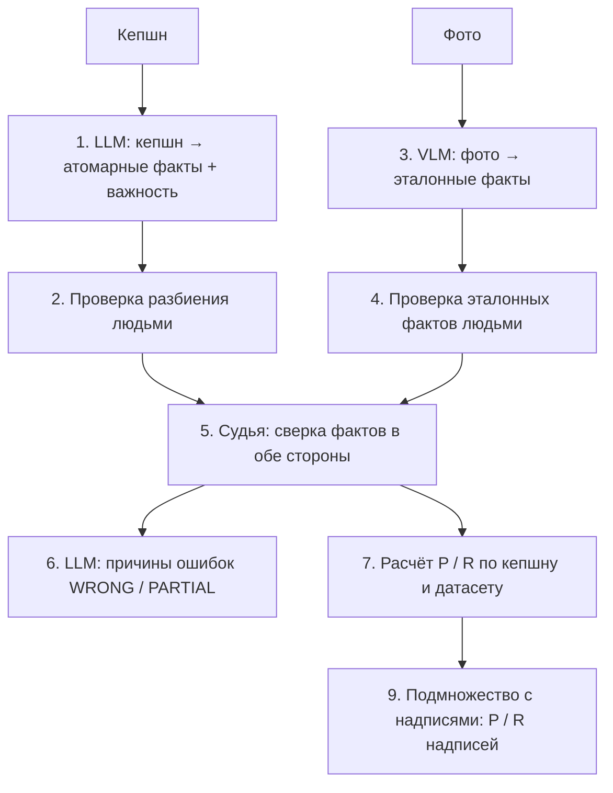

# i2t-caption-eval

**Проверяемая оценка image-to-text кепшнов на уровне фактов.**
Взвешенные Precision / Recall по атомарным фактам, гейты качества для LLM, которая эти факты
выделяет, отдельный протокол для надписей на фото. 

> Обезличенная версия подхода, который я разработала для оценки датасетов кепшнов, используемых при обучении генеративных моделей. Все числа получены на синтетике.

## Проблема

Кепшны к изображениям генерируются массово (VLM, метаданные или оба источника) и идут в модели генерации. Плохой кепшн тихо портит модель: выдуманные объекты учат неверным ассоциациям,
пропуски учат игнорировать детали, искажённые надписи учат рисовать искажённые надписи.

Одна оценка «поставь кепшну от 1 до 5» от LLM-судьи здесь не работает: она **непрозрачна** (не видно,
что именно не так), **нестабильна** (плывёт от формулировок и длины) и **одномерна** (кепшн может быть
абсолютно точным, но бесполезным, потому что описывает половину картинки).

Что нужно было получить:

1. Независимо проверить, насколько **каждый** кепшн соответствует фото, и оценить качество **всего датасета**.
2. Разделить «то, что написано, — неправда» (precision) и «то, о чём не написано» (recall).
3. Надписи на фото считать отдельной, намного более строгой задачей.
4. Измерить, сколько информации теряют укороченные варианты кепшна (для прунинга)
5. Сделать саму оценку **проверяемой людьми**, чтобы числам можно было доверять.

Примерные гейты (настраиваются): общий кепшн P ≥ 0.95, R ≥ 0.80; надписи P = R = 1.0.

## Подход

Сначала разложить, потом сравнить — никаких целостных оценок.

```
кепшн ──LLM──▶ атомарные факты ──судья по ФОТО──▶ Precision   «правда ли написанное?»
фото  ──VLM──▶ эталонные факты ──судья по КЕПШНУ──▶ Recall    «полно ли описано то, что есть?»
```

У каждого факта есть **важность** (critical / important / minor) и **категория** (объект, атрибут,
пространство, действие, стиль, камера, настроение, текст). Важность защищает метрику от
избыточной нарезки, категории делают ошибки диагностируемыми.

## Метрики и разобранный пример

```
score = Σ S_i · W_i / Σ W_i
```

| | Precision (кепшн → фото) | Recall (фото → кепшн) |
|---|---|---|
| Откуда факты | из кепшна | из независимого описания фото |
| S_i | 1 подтверждён · 0.5 частично · 0 неверен | 1 описан · 0.5 частично · 0 пропущен / неверен |
| W_i | critical 5 · important 3 · minor 1 | так же |

**Пример precision:** «красный маяк» (critical, full) → 5; «стоит на скалистом утёсе» (important, partial) → 1.5;
«три чайки» при двух на фото (minor, wrong) → 0; «под пасмурным небом» (important, full) → 3.
P = 9.5 / 12 = **0.79**; без весов было бы 0.63. Веса не дают одной неверной мелочи доминировать, а одной
неверной *критичной* детали — потеряться среди верных пустяков.

**Пример recall:** главный объект описан (5), «мокрая брусчатка» пропущена (0 из 3), «съёмка снизу» описана (3),
«лодка вдали» пропущена (0 из 1) → R = 8 / 12 = **0.67**.

Дополнительно (`metrics.py`): `GOOD` = P ≥ P_min, R ≥ R_min **и нет неверного critical-факта**; средние по датасету
идут с bootstrap-доверительными интервалами; F1 приведён только для удобства.

## Пайплайн



Люди проверяют разбиение периодически, а не на каждом запуске: после валидации метрика стабильна,
пока captioner не меняется радикально, и её можно калибровать раз в интервал.

## Доверие к измерению: гейты и верификация

Если LLM, нарезающая кепшн на факты, работает плохо, все числа дальше — шум. Поэтому каждое разбиение
проходит шесть гейтов (`facts.validate_caption_facts`):

1. выдача распарсилась;
2. ≥ 98% span-ов найдены в кепшне дословно (факты привязаны к тексту);
3. покрытие содержательных слов кепшна ≥ 0.90 (ничего важного не потеряно);
4. флаг «есть надпись» согласован с text-фактами, все цитаты восстановлены символ в символ;
5. почти-дубликатов ≤ 5% фактов;
6. главный объект покрыт critical-фактом.

Гейты показывают, *как часто экстрактор адекватен*; разметка асессорами (full / part / dup / wrong по каждому
факту) — *насколько он точен*. 
соответствия кепшна картинке.

## Надписи на фото

Надписи оцениваются на подмножестве фото с текстом по отдельному протоколу: одна неверная буква меняет смысл и
обучающий сигнал. Проверяем: текст есть, но не упомянут · прочитан с ошибками/частично · выдуман · неверный язык
или транслитерация · водяные знаки и логотипы описаны как контент. Цитаты сравниваются дословно после
нормализации (Unicode NFKC, casefold, обрезка пунктуации).


## Таксономия ошибок

| Группа | Проблемы |
|---|---|
| Надписи | не упомянуты · прочитаны с ошибками · выдуманы · неверный язык/транслит · водяной знак как контент |
| Корректность | галлюцинации · неверные атрибуты (цвет, материал, возраст, эмоции) · неверный счёт · неверные пространственные отношения · неверные медийные сущности |
| Полнота | нет главного объекта/действия · нет фона, композиции, ракурса · нет стиля/медиума · нет настроения, света |
| Стиль и формат | шаблонные обороты · повторы и растягивание · смесь языков |
| Уровень датасета | низкая диверсификация длин, источников, доменов, шаблонов |

Затем LLM присваивает причину каждому WRONG / PARTIAL; уверенность классификатора по темам отслеживается,
а темы с низкой уверенностью проверяются вручную.

## Ограничения

- Судья — LLM/VLM и может разделять слепые пятна с captioner-ом; человеческая верификация и калибровка — часть метода.
- Веса 5/3/1 — эвристика; стоит проверять чувствительность результатов к ним.
- Recall зависит от качества эталонных фактов VLM, которые тоже неполны.
- У pretrain и SFT разные цели: пороги и выводы — на каждый датасет отдельно.
- Малые пилотные выборки дают широкие интервалы — всегда смотрите bootstrap CI.


любой OpenAI-совместимый сервер (например vLLM): скопируйте `.env.example` в `.env` и задайте
`CAPTION_EVAL_BASE_URL` / `CAPTION_EVAL_MODEL`.

